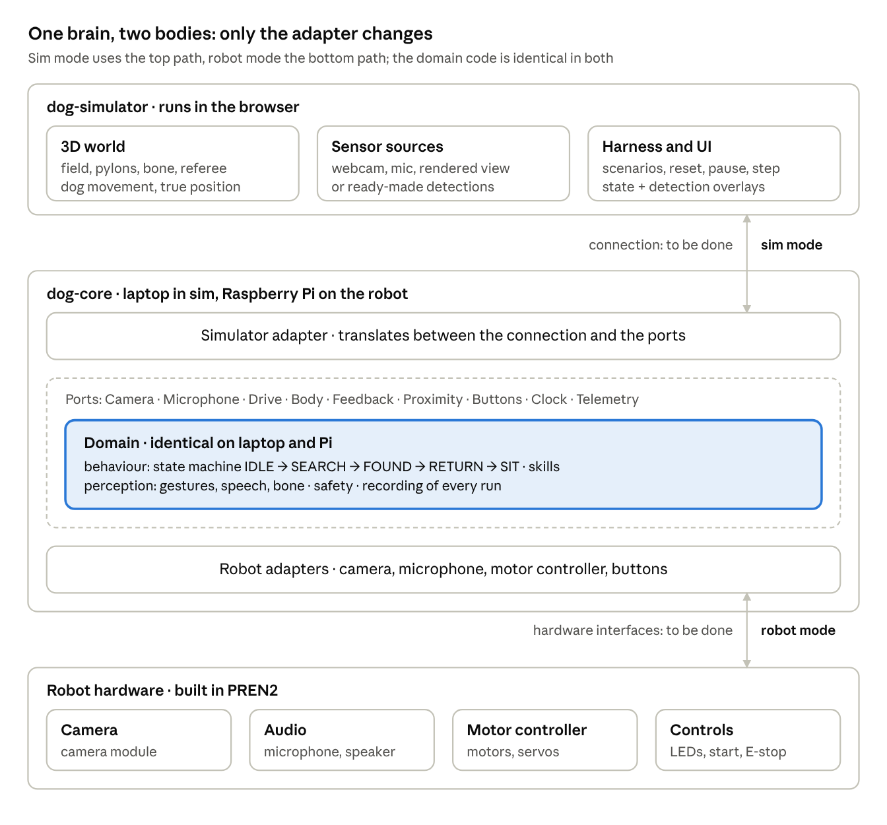
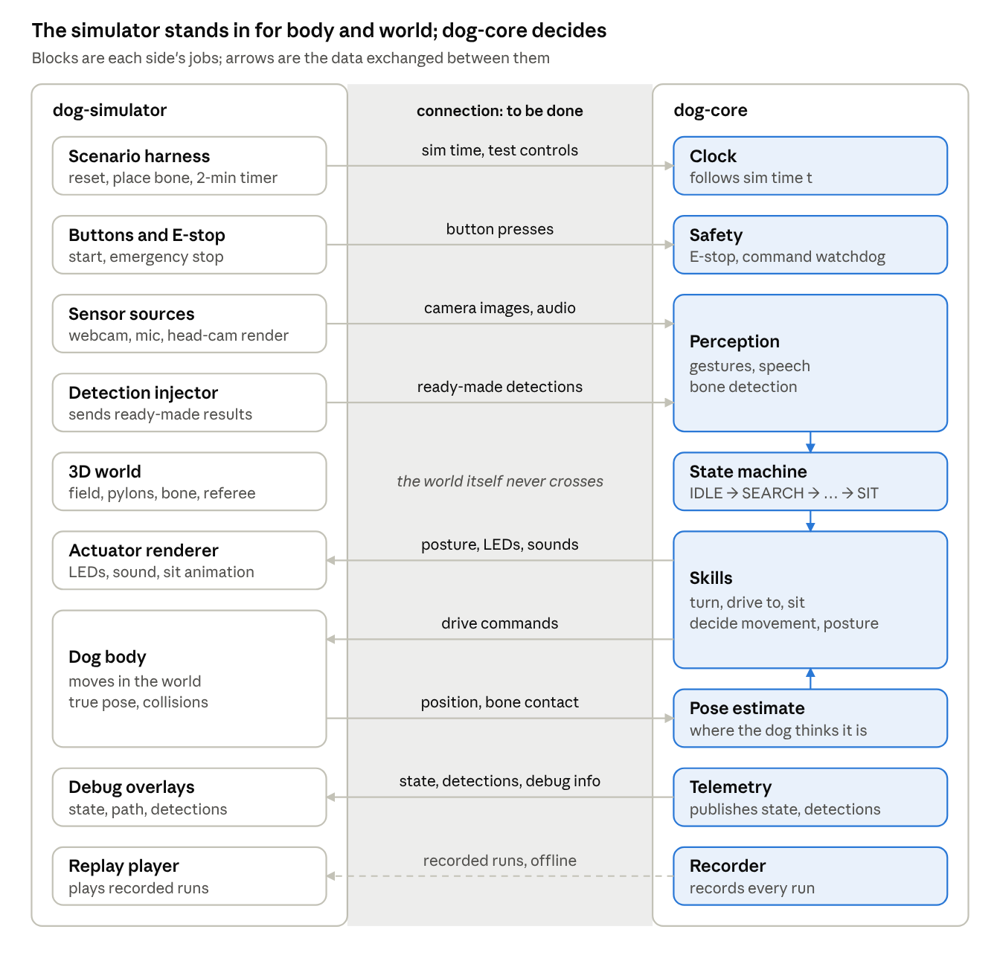
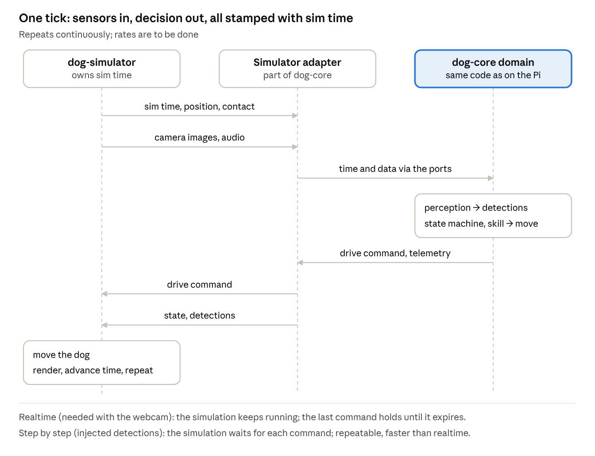

# dog-core ↔ dog-simulator: Architecture Concept

> Snapshot of the living doc in the Claude project "PREN" ([link](https://claude.ai/artifact/GXbWVMk89R6F31BmohGMAX)), taken 2026-11-06.
> The living doc is the source; change it there, then update this copy.

Scope: the broad picture, what runs where. Implementation details are marked *to be done*.
Simulator details are in [simulator.md](simulator.md), which builds on this doc; a change to blocks, ports or data here means a check there.

In the repo, "dog-core" is the brain: the packages `dog-core`, `dog-behavior`, `dog-perception` and `dog-recorder`.

## Verdict

Good approach. Splitting the dog's brain (dog-core) from its world and body (dog-simulator) means the logic tested in the simulator is the logic that later runs on the Raspberry Pi.

**What works**

- One brain, two bodies: behaviour and perception are built once and run in both places.
- A 3D scene can show what the dog's camera would see, which a 2D view cannot.
- The simulator can later double as a live view of the real robot.

**What to watch**

- dog-core must not depend on anything from the simulator; the two only meet at defined interfaces.
- The data exchanged is a shared contract both sides depend on. Its exact form is to be done.
- 3D costs more effort than 2D. Scope the scene to what MS3 (04.12.2026) needs. This replaces the 2D decision of 2026-10-02.
- Rendered images differ from real camera images, so bone detection tested on rendered images may not hold on the robot.

## System overview

In sim mode the browser is the dog's body and world; on the Pi the same domain code talks to real hardware through different adapters.

## Who does what

The rule: anything that is true on the real robot lives in dog-core; anything that stands in for physics, hardware or the competition field lives in the simulator.

Each arrow is one kind of data exchanged. The world itself never crosses: dog-core only gets what a real sensor would report.

| Concern | dog-core | dog-simulator |
| --- | --- | --- |
| Behaviour | State machine IDLE → SEARCH → FOUND → RETURN → SIT; skills turn, drive to, sit | Nothing |
| Perception | Recognizes gestures, speech and the bone | Supplies camera images and audio, or ready-made detections |
| Motion | Decides how to move; estimates its own position | Moves the dog in the world; knows the true position |
| World | Knows only what its sensors report | Field (~5 m), 30° search segment, pylons, start box, bone, referee |
| Time | Takes time from a clock it is given | Owns sim time; can pause, step and speed up |
| Feedback | Decides on LEDs, sounds, posture | Shows them in the scene |
| Safety | Stops on E-stop or when data goes missing | Offers an E-stop; stops the dog when commands stop |
| Recording | Records every run | Plays recordings back |
| Test setup | Nothing | Scenarios: place the bone, reset, trigger commands, 2-minute timer |

## dog-core interfaces

dog-core needs one interface (port) for everything that crosses its boundary. In sim mode the simulator provides all of them; on the Pi the robot hardware does. How each port is implemented is to be done.

| Port | Direction | What crosses | In the simulator | On the robot |
| --- | --- | --- | --- | --- |
| Camera | in | Images | Webcam or rendered dog's-eye view, switched automatically by the simulator | Camera module |
| Microphone | in | Audio | Laptop microphone | Microphone |
| Drive | out + in | Movement commands; position back | Moves the virtual dog | Motors via motor controller |
| Body | out | Posture (sit, stand, down), trick | Animation | Servos |
| Feedback | out | LEDs, sounds | Shown in the scene | LEDs, speaker |
| Proximity | in | Distance, bone touched | From the scene | Sensor to be decided by the hardware team |
| Buttons | in | Start, emergency stop | Buttons in the UI | Physical buttons |
| Clock | in | Current time | Sim time (pause, speed up) | Real time |
| Telemetry | out | State, detections, debug info | Drawn in the scene | Recorded; optional live view |

**Perception can be fed at three levels**, chosen per sensor:

- **Injected:** the simulator sends ready-made results ("SITZ recognized", "bone ahead at 2 m"). Tests the logic only.
- **Rendered:** images from the 3D scene go through the real recognizers.
- **Real:** laptop webcam and microphone go through the real recognizers, as on the robot.

**Test controls are not a port.** Reset, placing the dog, bone and referee, pause and step exist on the simulator side only, so the real robot cannot be controlled from outside.

## Data exchanged

The simulator sends what a real robot's sensors would report. dog-core sends back what it would command the hardware to do, plus information for display.

**Simulator → dog-core**

- Camera images and audio
- Position and movement of the dog; contact with the bone
- Button presses: start, emergency stop
- Ready-made detections (injected level only)
- Sim time
- Test controls: reset, pause, step

**dog-core → Simulator**

- Drive commands (speed, turning)
- Posture and trick commands
- LED and sound commands
- Current state and why it changed
- Detections and debug info for display

**Principles**

- Everything carries one shared time, so runs can be recorded and replayed.
- Drive commands expire unless renewed, so the dog stops when dog-core stops responding.
- Both sides use one shared definition of the data (`packages/dog-protocol`).

**To be done:** data format, update rates, units and coordinate conventions, transport.

## Interaction loop

The simulator owns time: every piece of sensor data carries it, dog-core uses it as its clock, and everything sent back carries the same time. That is what makes runs recordable and replayable.

## Where it runs

dog-core runs as its own program and the simulator connects to it. How they connect is to be done.

1. **Simulation:** a laptop runs dog-core (`apps/sim-host`) and the simulator (`apps/dog-simulator`); the simulator is the world and the body.
2. **Robot:** the Raspberry Pi runs dog-core with the real hardware (`apps/robot`), fully autonomous, no network.
3. **Live view (optional, PREN2):** the simulator mirrors the real robot during testing. The robot never needs it; off at the competition.
4. **Replay:** the simulator plays back a recorded run.

**To be done:** connection technology, packaging and installation on the Pi.

## What has to be done where

Everything is still to be done. The goal for MS3 (04.12.2026) is one complete search run in the simulator.

| Work | Where | Status |
| --- | --- | --- |
| Define the ports between dog-core and the outside | dog-core | To be done |
| State machine and skills | dog-core | To be done |
| Perception: gestures, speech, bone | dog-core | To be done |
| Safety: E-stop, stop when data goes missing | dog-core | To be done |
| Recording of every run | dog-core | To be done |
| Simulator adapter on the dog-core side | dog-core | To be done |
| Robot adapters: camera, microphone, motors, buttons | dog-core | To be done |
| Shared definition of the data exchanged | shared | To be done |
| Connection between simulator and dog-core | shared | To be done |
| 3D world: field, pylons, bone, referee | dog-simulator | To be done |
| Dog body and movement | dog-simulator | To be done |
| Sensor sources: webcam, microphone, rendered view | dog-simulator | To be done |
| Detection injector | dog-simulator | To be done |
| Display of LEDs, sounds, posture, overlays | dog-simulator | To be done |
| Test scenarios and controls | dog-simulator | To be done |
| Replay of recorded runs | dog-simulator | To be done |
| Sensor for detecting bone contact | hardware team | To be done |

**To be decided later (implementation)**

- Simulator technology: decided, React with Three.js through React Three Fiber (see [simulator.md](simulator.md))
- Connection and data format between the two (proposed: WebSocket, JSON plus binary, Pydantic models with generated TypeScript types)
- Recording format and viewer (candidates: Rerun or Foxglove; Rerun could also be embedded in the simulator as its replay viewer)
- Packaging and installation on the Pi (repo structure: done, see the repo README)
- Testing approach

**Open questions**

- Is the split Raspberry Pi + motor controller confirmed? It decides where the robot's position comes from.
- How does the robot sense that it touched the bone?
- Sit and trick: real posture with servos, or stop plus sound?
- Does the simulator need to run step by step for MS3, or is realtime enough?
