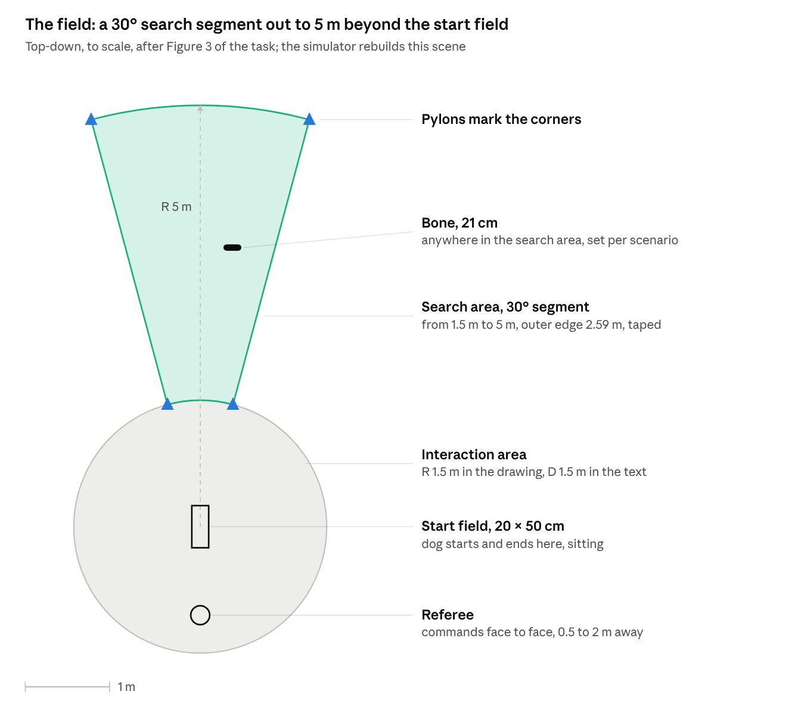
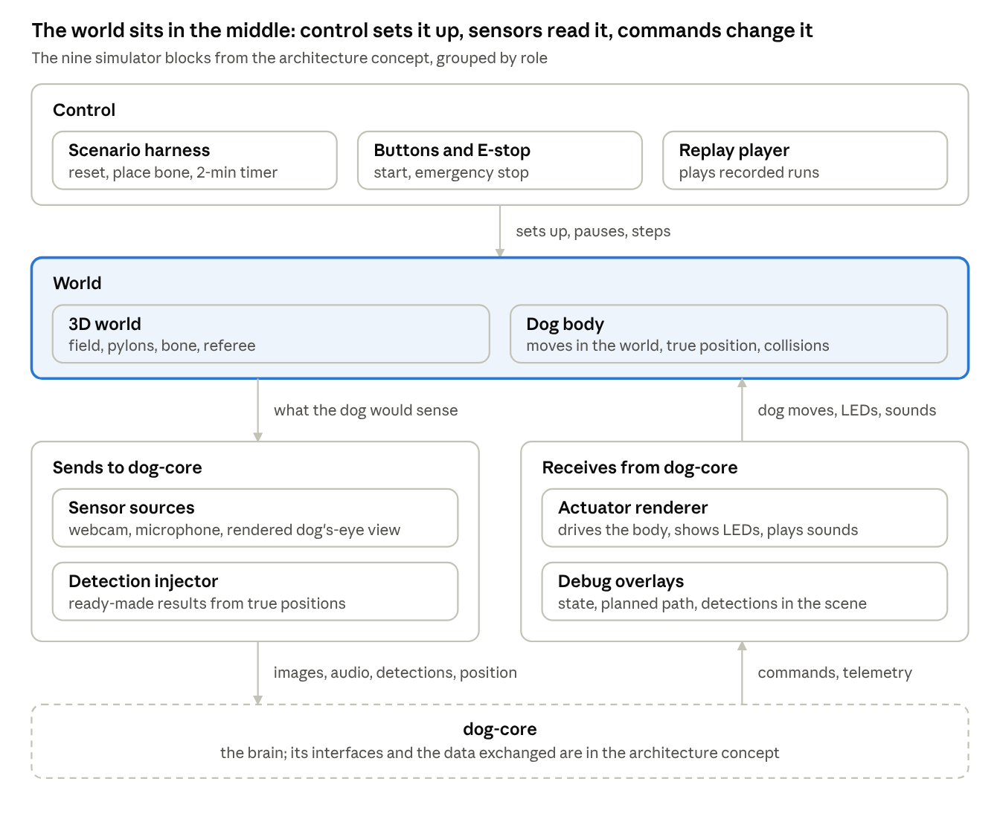

# dog-simulator: Simulator Concept

> Snapshot of the living doc in the Claude project "PREN" ([link](https://claude.ai/artifact/4TWsCKcR2yZvwG8SfzGcrK)), taken 2026-11-06.
> The living doc is the source; change it there, then update this copy.

Scope: the broad picture of the simulator. Interfaces, data exchanged and the split of responsibilities are defined in [architecture.md](architecture.md); this doc only refers to them, so a change there means a check here. The user interface is designed later and derived from this concept. Implementation details are marked *to be done*.

## Purpose

The simulator lets the team develop and test dog-core without the robot, and shows what the dog is doing and why. The task (section 3.3) asks for exactly this: make command recognition and the bone search visible, document and test them through PREN1 and PREN2, and deliver a first working version by the end of PREN1 (MS3, 04.12.2026).

**Goals**

- **Develop without hardware:** dog-core runs a complete competition run against a virtual dog and field.
- **Make it understandable:** at any moment you can see the dog's state, what it recognized and why it decided what it did.
- **Test repeatably:** the same situation can be set up and run again, for example the bone at a given spot.
- **Reduce risk and cost:** find logic errors before parts are bought or built, as the task names (risk, cost and material savings, process optimization).

**Not the goal:** realistic physics, or replacing tests on the real robot.

## Users and use cases

Proposal to discuss: the simulator serves mainly the software developers, but it must also be clear enough for the team and supervisors to follow.

| Who | Uses it to |
| --- | --- |
| Software developers | Build and debug dog-core without the robot |
| Whole team | Check that the concept works end to end; agree on the dog's behaviour |
| Supervisors (MS3) | See the first working version and the process steps |
| Hardware tests in PREN2 | Compare real runs with simulated ones |

**Use cases**

1. **Full run:** play the whole competition sequence, commands then search then return.
2. **Command test:** give voice and gesture commands yourself through webcam and microphone.
3. **Search test:** place the bone, run the search, repeat with other positions.
4. **Investigate:** replay a recorded run and see why the dog decided what it did.
5. **Show:** demo for MS3, screenshots and video for the report.

## The scene

The 3D world rebuilds the competition field from Figure 3 of the task, at true scale, with only what the dog's sensors or the run need.

The dog takes commands facing the referee, turns into the search area for SUCH, touches and reports the bone, and returns to sit in the start field within 2 minutes.

| Object | From the task | In the simulator |
| --- | --- | --- |
| Search area | 30° segment, radius 5 m, marked with tape | Tape outline on the floor |
| Pylons | Mark the corner points | Simple cones |
| Start field | 20 × 50 cm, marked with tape | Tape rectangle |
| Interaction area | Commands face to face, 0.5–2 m away | Circle around the start field |
| Bone | White chew bone, 21 cm, sample provided | Simple white bone; position set per scenario |
| Referee | Unknown person, gives 2 voice and 2 gesture commands | Stand-in figure; the real person via webcam |
| Dog | Max 20 × 50 × 50 cm at start, max 1 m long in action, wheels allowed | Simple body with a head camera; exact shape to be done |
| Floor | Indoor, e.g. canteen or lecture hall | Plain floor; look to be done |

Open: the drawing says interaction area R 1.5 m, the text says D 1.5 m. To check with the supervisors.

## Building blocks

The simulator has nine blocks in four roles. The world in the middle is the only thing dog-core never sees directly.

Block names match the architecture concept's block diagram; a block added or renamed there changes here too.

## Perception levels

The simulator feeds dog-core's perception at one of three levels, chosen per sensor and per scenario. The levels are defined in the architecture concept; this is what each means for the simulator.

| Level | The simulator sends | What it tests | Good for |
| --- | --- | --- | --- |
| Injected | Ready-made results: "SITZ recognized", "bone 12° left, 2 m" | Behaviour and search logic only | Fast, repeatable search tests, step by step |
| Rendered | Images of the 3D scene from the dog's camera | Bone detection on rendered images, plus the logic | Checking camera position and field of view |
| Real | Laptop webcam and microphone | Real command recognition, plus the logic | Command tests with real people |

Typical mix: commands at Real with a person in front of the laptop, search at Injected. Rendered is a bonus, since rendered images differ from real ones.

**To be done:** how injected results get realistic errors, for example from detection rates measured in the workbench.

## Modes

The simulator has three modes: Live, Scenario and Replay. All three show the same information. They differ in who sets up the scene, who gives the commands, and whether the result is judged.

| | Live | Scenario | Replay |
| --- | --- | --- | --- |
| Purpose | Try things out, demo | Test whether the dog behaves correctly | Find out what happened in a past run |
| Scene setup | You place the dog, bone and referee in the 3D view | Fixed by the scenario | From the recording |
| Commands | You, via webcam and microphone | Injected by the scenario, or you live | From the recording |
| Order of events | Free | Scripted | As recorded; pause, step, rewind |
| Result | You watch what happens | Pass or fail, checked automatically | A timeline to inspect |
| Repeatable | No | Yes | Yes |
| Available | MS3 | MS3 | PREN2 |

**Live mode.** You place the dog, the bone and the referee anywhere in the 3D view, then talk and gesture in front of the laptop. dog-core reacts as it would on the field: you see what was recognized, why the dog reacted, and the dog acting in the 3D scene. SUCH starts the search and the 2-minute timer.

**Camera switch.** The simulator switches the dog's camera automatically, so dog-core always gets one camera image, as on the robot. Proposed rule, to confirm: while the dog faces the referee the image is the webcam; when it turns away, it is the rendered dog's-eye view.

**Replay viewer (PREN2).** Candidate: [Rerun](https://rerun.io/), embedded in the simulator. It shows camera images, detections, state changes and plots on one timeline, for simulator and robot runs alike, so the team would not build its own replay viewer. It does not replace the 3D world or Live mode. To be decided, together with the recording format in the architecture concept.

**To be done:** how placing works in the 3D view; what happens to dog-core's position when the dog is moved during a run.

## Scenarios

At MS3 the simulator supports four kinds of scenario. Each sets up the scene, runs, and shows whether the dog passed.

**The competition run** (task, sections 2, 3.1 and 3.5), the reference for every scenario:

1. The team starts the dog in the start field (max 1 minute to get ready).
2. The referee gives 2 voice and 2 gesture commands face to face; each must be clearly acknowledged.
3. SUCH, or touching the dog's button, starts the search and the clock.
4. The dog turns into the search area, head first.
5. It finds and touches the bone, then reports the find.
6. It returns to the start field head first and sits, with a sound. The clock stops.
7. An unfinished search is aborted after 2 minutes. The E-stop interrupts at any time.

| Scenario | Setup | Passes when | Perception level |
| --- | --- | --- | --- |
| Full competition run | Dog in the start field, bone in the search area, referee in front | Commands acknowledged; bone touched and reported; dog sitting in the start field with sound within 2 min | Commands Real or Injected; search Injected |
| Search only | Dog in the start field, bone at a chosen or random position | Bone touched and reported; back and sitting within 2 min | Injected, later Rendered |
| Commands only | Dog in the start field, referee in front | Voice HIER, BRAV, SITZ, SUCH and gestures SITZ, PLATZ, AUF each clearly acknowledged | Real or Injected |
| Failure cases | Unknown word, no or unclear gesture, bone at the edge, E-stop pressed, search past 2 min | The dog reacts as defined and stays safe: stops on E-stop, aborts at 2 min | Injected |

**To be done:** the dog's defined reaction to each failure case, how scenarios are described and saved (`scenarios/`), how pass and fail are shown.

## Scope and open questions

MS3 (04.12.2026) delivers one complete run first, then real commands, then a presentable scene. Everything else moves to PREN2.

**MS3 priorities, in order**

1. **Full run, injected:** one complete competition run end to end with ready-made detections.
2. **Real commands:** voice and gesture commands through webcam and microphone.
3. **Demo visuals:** a 3D scene clear enough to show the supervisors.

| Topic | MS3 | PREN2 |
| --- | --- | --- |
| Must be visible | The scene, what the dog sees, what was recognized, the dog's state and why | Refined as needed |
| Modes | Live, Scenario | Replay |
| Scenarios | Full run, search only, commands only, failure cases | More cases from real tests |
| Perception levels | Injected, Real | Rendered |
| Replay of recorded runs | Not included | Included |
| Trick (Kunststück) | Not included | Once the trick is defined |
| Live view of the real robot | Not included | Optional |

**Open questions**

- Interaction area: R 1.5 m in the drawing, D 1.5 m in the text. Which applies?
- Where does the referee stand, and which way does the dog face at the start?
- How do injected detections get realistic errors?
- Which failure reactions does the dog need, for example on an unknown word?
