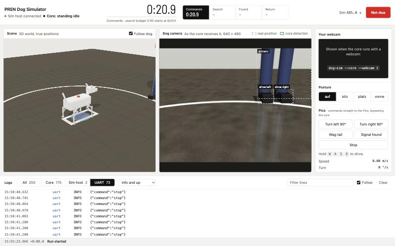
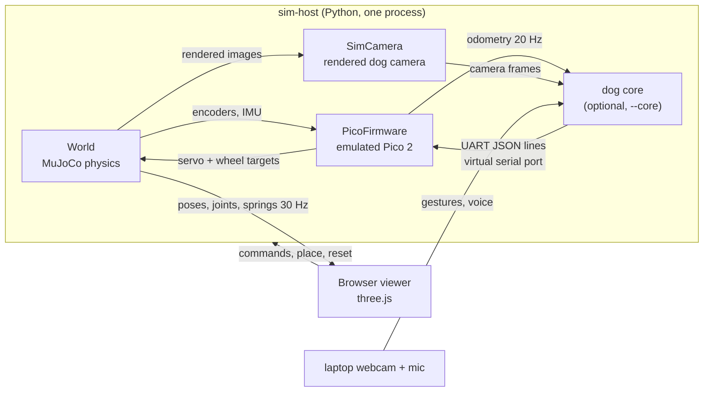

# Simulator overview

The simulator replaces the robot's **body and world** so the **brain** (the dog core) can be
developed and tested on a laptop. The core cannot tell the difference: it talks to the same
serial port protocol and reads camera, microphone and recognition results through the same calls.

{ loading=lazy }

## Run it

Two terminals, from the repo root:

```bash
uv run dog-sim
```

```bash
npm --prefix apps/dog-simulator install && npm --prefix apps/dog-simulator run dev
```

Open <http://localhost:5173>. Drive with **W A S D**, try the posture buttons, drag the view.
To let the real dog core control it, see [core integration](core-integration.md): `apps/sim-host/scripts/core-env.sh`, then `.venv-core/bin/dog-sim --core`.

| Option | Default | Meaning |
| --- | --- | --- |
| `--port` | `8780` | WebSocket port the viewer connects to |
| `--link` | `/tmp/pren-uart-pi` | symlink to the virtual serial port the core opens |
| `--core` | off | also run the dog core inside the simulator |
| `--webcam` | `0` | with `--core`: laptop camera for gestures, `-1` for none |

## How it fits together



| Part | Real robot | Simulator |
| --- | --- | --- |
| Body, motors, sensors | hardware | [MuJoCo model](robot-model.md) |
| Pico 2 firmware | C on the Pico | [`PicoFirmware`](pico-emulator.md) |
| UART cable | `/dev/serial0` | pseudo-terminal at `/tmp/pren-uart-pi` |
| Camera + YOLO | Pi camera, `ObjectModel` | dog's view rendered by MuJoCo, the core's own YOLO |
| Microphone + Vosk | USB mic, `AudioModel` | laptop microphone, the core's own Vosk |
| Hand gestures | camera, `GestureModel` | laptop webcam, the core's own gesture model |

## What runs where

- `apps/sim-host`: Python package `dog_sim_host`. Physics, Pico emulator, serial port, WebSocket server.
- `apps/dog-simulator`: the browser viewer (Vite + three.js). It only draws; it simulates nothing.
- `packages/dog-protocol`: the WebSocket messages between the two.

Checks: `uv run pytest apps/sim-host` (physics, Pico, serial link, camera projection) and
`npm --prefix apps/dog-simulator run typecheck`.
