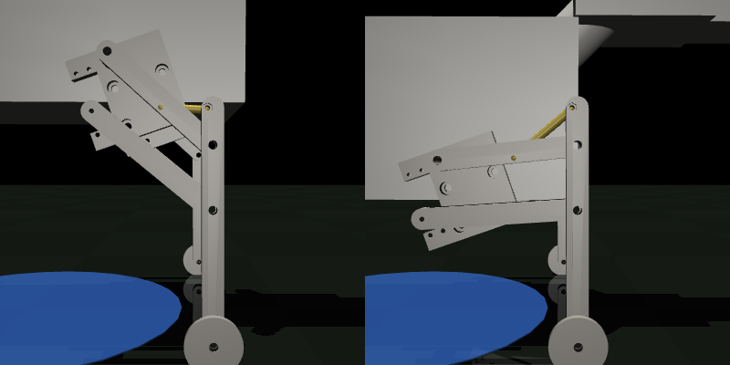

# Robot model

The robot is described in MJCF, MuJoCo's XML format:

- `apps/sim-host/src/dog_sim_host/assets/dog.xml`: the robot
- `apps/sim-host/src/dog_sim_host/assets/scene.xml`: floor, home spot, bone and person; includes `dog.xml`

Axes: **x forwards, y to the dog's left, z up**. Units: metres, kilograms, radians.
The dog starts at home (the origin) facing +x.

!!! warning "Partly placeholder numbers"
    The legs come from the CAD parts of the leg test setup (STL files in
    `assets/meshes/STL`). Torso, head, tail, masses and the spring are still guesses from the
    flipchart drawing. Every assumption is listed below. After a change, run
    `uv run pytest apps/sim-host` and update this page.

## From the drawing and CAD to the model

| Drawing / CAD part | In `dog.xml` | Source |
| --- | --- | --- |
| Body | `torso` box 0.40 × 0.18 × 0.14 m, 2.0 kg | drawing; emergency stop ("Not") and speaker are decoration |
| Kopf + Servo-Kopf | `head` body, `neck` hinge (z axis), position servo 0.4 Nm | drawing; carries camera, ears, LED matrix |
| Kamera-Modul | `eye` camera on top of the snout, 48.8° vertical field of view, tilted 20° down | Pi camera v2 |
| Servo-Schwanz | `tail` hinge, position servo 0.2 Nm | drawing |
| Grundkörper.stl | `plate_*`, one mounting plate per leg, fixed to the torso | CAD; two of the four are mirrored |
| MG946R | `servo_*` hinge + position actuator `hip_*`, 1.3 Nm, kp 25 | datasheet; shaft position assumed (see below) |
| Antriebsstütze.stl | `crank_*`, turned by the servo, 107.4 mm between holes | CAD |
| linkage.stl (+ Achse_linkage) | `linkage_*` on the hip axle (`hip_*` joint), 97.2 mm | CAD |
| Bein.stl | `leg_*` on the `knee_*` joint, joints at 25 / 69 mm, wheel at 160 mm | CAD |
| Rad.stl (+ Achse_Rad) | `wheel_left` / `wheel_right` on the front legs, r = 20 mm | CAD; velocity actuators, 0.6 Nm |
| Rear wheels | Rad drawn, frictionless `caster_rear_*` balls touch the floor | assumption, so the dog can turn |
| Zugfeder | `spring_*` tendons between linkage and leg, 600 N/m, pull above 20 mm | hooks from CAD; stiffness guessed |
| Encoder links/rechts | `encoder_left` / `encoder_right` sensors on the wheel joints | distance = angle × radius |
| IMU | `imu_orientation`, `imu_gyro`, `imu_accel` on the `imu` site | heading reported clockwise |
| Ultraschallsensor | `sonar` rangefinder on the chest | shown in the viewer only |

Masses of the CAD parts come from their volume at 1250 kg/m³ (3D printed PLA, assumed):
plate 45 g, drive strut 16 g, linkage 20 g, leg 31 g, wheel 8 g. The whole dog weighs 2.8 kg.

### The leg mechanism

{ loading=lazy }

Each leg is a four-bar linkage, built like the CAD test setup:

```
  plate (fixed to the torso)
   ● hip axle ─── linkage 97.2 ───● knee
   │                              │ leg 44 mm between joints
   ● servo ──── drive strut 107.4 ─●
                                   │
                                   │ leg continues 91 mm
                                   ◎ wheel (Rad, r 20 mm)
```

The two ground pivots sit 42.6 mm apart and the leg's two joints 44 mm apart, so the
linkage is nearly a parallelogram: **the leg stays upright while the servo raises or lowers
the body.** The drive strut is 10 mm longer than the linkage, so the leg tilts a few degrees
over the travel.

`apps/sim-host/scripts/build_legs.py` builds the legs from the hole positions. It closes the
four-bar, turns each plate so the leg points straight down in `auf`, stacks the parts
sideways (plate, bars, leg, wheel), and writes the block between `legs:begin` and `legs:end`
in `dog.xml`. After a CAD change, update the hole positions at the top of the script and run:

```bash
uv run python apps/sim-host/scripts/build_legs.py
```

Assumptions in the script, to confirm with the hardware team:

- **Servo shaft** at (−64, 24.85) mm on the plate: 10 mm from the centre of the servo's
  mounting holes. The other end of the servo (24.85 → 44.85) would make a very different
  linkage.
- **Pairing**: hip axle → linkage → upper leg joint, servo → drive strut → lower leg joint.
- **Spring hooks**: the small offset holes in the linkage (−53, 4) and the leg (0, 4).
- **`auf`** has the crank 40° below horizontal (`AUF_CRANK`), legs nearly stretched.

## Postures

Servo angles relative to `auf`; positive lowers the body. They live in `pico.py` (`POSTURES`).
The servo range in `dog.xml` is −0.6 to 0.8 rad.

| Posture | Front | Rear | Torso height | Servo load front / rear (of 1.3 Nm) |
| --- | --- | --- | --- | --- |
| `auf` | 0 | 0 | 0.26 m | 0.35 / 0.19 Nm |
| `sitz` | 0 | +0.7 | rear lowered, nose up 11° | 0.30 / 0.25 Nm |
| `platz` | +0.75 | +0.75 | 0.18 m | 0.34 / 0.16 Nm |
| `vorderbeine_runter` | +0.75 | 0 | nose down 12° | 0.45 Nm front |

## Findings so far

These come from the mechanics, not from exact numbers.

From the CAD legs (iteration 2):

1. **The springs matter.** Without them each front servo holds 0.61 Nm standing, half its
   stall torque. A 600 N/m spring between the linkage and leg hooks brings that to 0.35 Nm.
   The spring stretches when the body goes down, so it helps exactly where gravity pulls.
   The real Zugfeder's rate and length decide how much it helps.
2. **A leg can snap through.** If the servo jumps a large angle at once, the four-bar can
   flip into its crossed pose and stay there. The model has a knee stop at 80° and the
   emulated Pico ramps the servos; the real leg may want a mechanical stop too.
3. **Raising is harder than lowering.** Lifting the body above `auf` (−0.6 rad) needs
   about 0.9 Nm per front servo, 70% of stall. No posture uses it.

From the first, drawing-based model (iteration 1), still true:

4. **Let the wheels coast while the legs move.** When the legs move, the wheels have to roll.
   With the H-bridge braking, the servos stall. The emulated Pico coasts while the leg
   servos move and brakes otherwise.
5. **Turning in place pivots around the driven front axle**, not the body centre.
6. **A camera looking straight ahead misses the floor near the dog.** Tilted 20° down, it
   sees the floor from about 0.3 m. In the eye socket, the snout hid a quarter of the image.

## The world

`scene.xml` holds the floor, the home spot, the bone and the person, made to look like the
competition so the core's detector works on the rendered images (see
[core integration](core-integration.md#findings-for-the-core-team)):

- **Bone**: the scan of a real bone (`meshes/STL/Knochen.stl`, 685,000 triangles, 29 cm).
  `scripts/prepare_bone.py` lays it flat, scales it to the competition bone's 21 cm and
  reduces it to `Knochen_sim.stl` (4,000 triangles). White, slightly glossy.
- **Floor**: the playing field's dark, glossy, scratched linoleum, colour measured from a photo
  of the taped field; `floor.png` is made by `scripts/make_floor_texture.py`.
- **Light**: a bright headlight and a light sky, like an indoor room.
- **Field** (photo of the taped field and task drawing): the dog starts in a 20 × 50 cm start
  field in the middle of a taped circle of 1.5 m radius (the interaction area). The search
  area is a 30° segment with its tip at the dog, behind it: two tape lines from the circle to
  5 m, where the pylons stand. The circle is open between the lines; there is no far arc.
  White tape, 5 cm. `scripts/build_field.py` generates it into `scene.xml`.
- **Viewer-only marker** (geom group 4): the home disk. It is not on the real floor, so the
  dog's camera does not render it.

```bash
uv run --no-project --with trimesh --with fast-simplification python apps/sim-host/scripts/prepare_bone.py
```

```bash
.venv-core/bin/python apps/sim-host/scripts/make_floor_texture.py
```

```bash
.venv/bin/python apps/sim-host/scripts/build_field.py
```

## Changing the model

- Open `dog.xml` in MuJoCo's own viewer to look at it alone: `uv run python -m mujoco.viewer --mjcf apps/sim-host/src/dog_sim_host/assets/scene.xml`.
- Every geom is drawn by the browser automatically. New parts need no viewer change.
- Wheel radius, track width and wheelbase are read from the model by the Pico emulator.
- Legs: edit `scripts/build_legs.py`, not the generated block in `dog.xml`.
- A new CAD part: add its STL under `assets/meshes/STL`, a `<mesh>` in `dog.xml` (scale 0.001,
  the files are in millimetres) and a geom with `class="part"`. The viewer draws it without changes.
