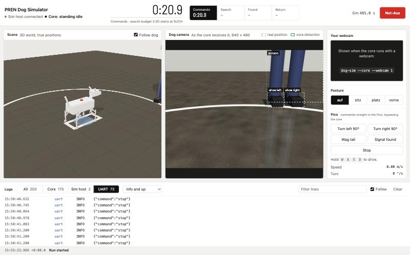

# Browser viewer

`apps/dog-simulator` draws what the sim host simulates and sends the user's commands back.
It simulates nothing itself, so it can be restyled freely without changing behaviour.

{ loading=lazy }

## Layout

Light theme, after race timing graphics: the competition run reads like a timed race.

| Area | Shows |
| --- | --- |
| Top bar | connection and core state; the **run clock**, started by SUCH; one **split** per phase (Commands, Search, Found, Return): black while running, green when done, red past the 2-minute search budget; sim time; **Not-Aus** |
| Scene | the 3D world with true positions; click the floor to place things; *Follow dog* |
| Dog camera | **as large as it fits, at 4:3**: the image the core's detector gets (with the core running), else the viewer's own rendering. Dashed white: where objects really are; green: what the core's YOLO found, with its confidence |
| Rail | **your webcam** (what the core's gesture model sees), posture, Pico commands, world, sensors, motors |
| Log dock | **every log line**: core, sim host and UART commands, with source and level filters, text search, *Follow*; drag the top edge (or use the arrow keys on it) to resize |

Below 1100 px wide, scene and camera stay side by side and the rail moves below them; on a
phone everything stacks.

## Files

| File | Job |
| --- | --- |
| `index.html` | the layout above |
| `src/main.js` | starts everything; camera and webcam images; fits the camera view; placing with a floor click |
| `src/connection.js` | WebSocket to the sim host, reconnects every second; binary messages are images |
| `src/scene.js` | three.js scene: one mesh per MuJoCo geom, trail, springs; the dog's camera view as a fallback |
| `src/run.js` | run clock and splits, from the core's state |
| `src/logs.js` | the log dock: list, filters, search, follow, resizing |
| `src/panel.js` | buttons, keyboard driving, readouts, the boxes over the camera |
| `src/protocol.js` | JSDoc types of the messages; mirrors `dog_protocol` |
| `src/style.css` | the light theme; one 8 px spacing unit, colours as custom properties |

## What the sim host sends

1. On connect: a **scene** message (every geom's shape, size and colour, plus the triangles of
   every CAD mesh) and a **logs** message with everything logged so far.
2. About 30 times a second: a **frame** (poses, the dog's camera pose, joints, sensors, springs,
   the core's state and detections) and a **logs** message with any new lines.
3. With the core running, **binary messages**, one byte for which image, then a JPEG:
   `0` the dog's camera as the core gets it (15 per second), `1` the webcam the core's gesture
   model watches (10 per second). When they stop for a second, the viewer falls back to its own
   rendering and the webcam's empty state.

The core's detections come from its own log lines (`Bone bounding box: …`), so green boxes
appear only while the core is searching (SUCH) or looking for the person (HIER). The run clock
reads the core's state: everything before `searching` is Commands, then Search, `found`,
`returning`; the run ends when the core stands or sits again.

The world is z-up like MuJoCo, so poses are copied without converting (`DEFAULT_UP` is set to z).

## Controls

| Control | Sends |
| --- | --- |
| Posture, Pico buttons, W A S D | `pico`, a UART command straight to the emulated Pico |
| Not-Aus | `emergency_stop` |
| Place bone / person, then click the floor (<kbd>R</kbd> turns the bone 45° each) | `place` with `yaw` |
| Reset everything | `reset`: world and Pico back to the start; with the core, the whole sim host restarts (about 5 s) so the core starts fresh too |

## Code conventions

Every file starts with `// @ts-check` and a `@file` comment. Every function and class has a JSDoc
block with its parameter types. `npm run typecheck` runs TypeScript over the JSDoc types, so a wrong
field name in a message fails the check.

```bash
npm --prefix apps/dog-simulator run typecheck
```
